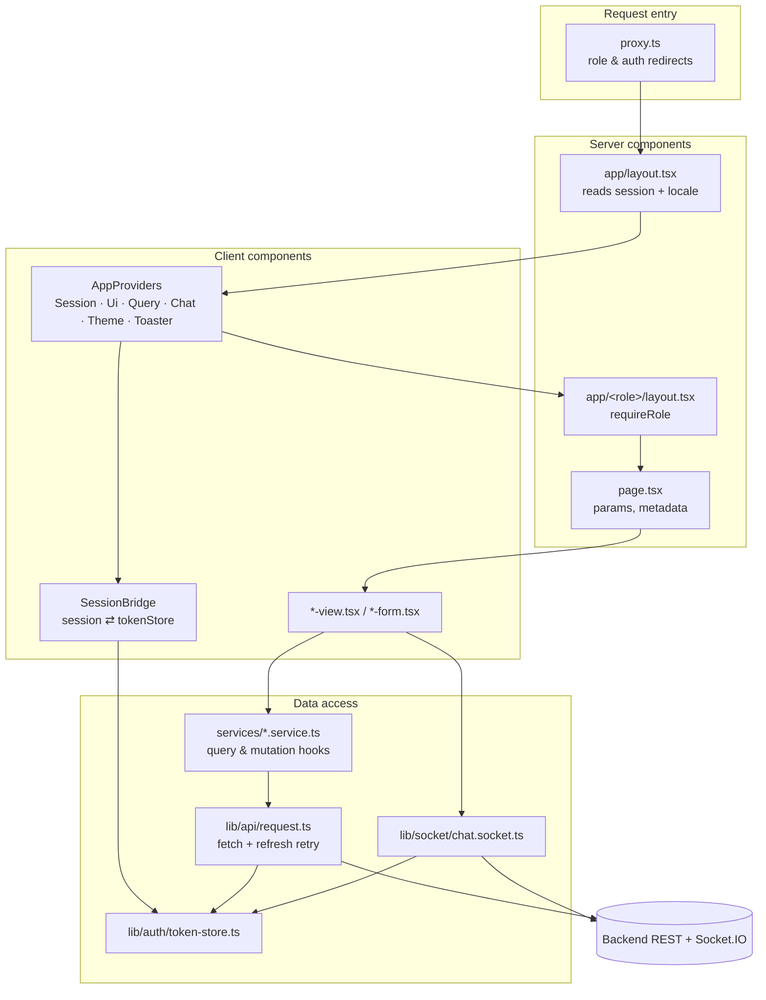

# 1. Core Architecture & Implementation Design

This is the foundation. Every later document zooms into one box of the diagrams
below.

## 1.1 What the client is (and is not)

The client is a **thin, role-based front end** over a separate backend REST API
(`API_URL`, default `http://localhost:9090`). It owns:

- presentation, routing and role gating,
- the user session (via Auth.js), including token refresh,
- client-side caching of API data (Context-based query cache over `fetch`),
- realtime chat (Socket.IO) and push notifications (FCM),
- translations (English / Arabic).

It does **not** own business rules or persistence. Validation in the client is a
convenience; the backend is the source of truth and its error messages are shown
to the user as-is (they are already localized through the `x-language` header).

## 1.2 Technology stack

| Concern | Library | Where |
|---------|---------|-------|
| Framework | Next.js 16.4 (App Router), React 19.3 | `app/` |
| Language | TypeScript (strict), path alias `@/*` → repo root | `tsconfig.json` |
| Session | Auth.js / `next-auth` v5 (JWT strategy) | `auth.ts`, `proxy.ts`, `lib/auth/` |
| Server data | `fetch` + small query cache (`lib/query`) | `src/services/` |
| Client state | React Context | `src/contexts/` |
| Realtime | `socket.io-client` | `src/lib/socket/` |
| Push | Firebase Cloud Messaging | `lib/firebase.ts`, `hooks/use-push-notifications.ts`, `public/firebase-messaging-sw.js` |
| i18n | `next-intl` | `src/i18n/` (request config + messages), `src/lib/i18n/` |
| Forms | `react-hook-form` + `zod` v4 | `validation/`, `components/form/` |
| UI | Tailwind CSS v4, shadcn/ui on `@base-ui/react`, `lucide-react`, `sonner` | `components/ui/`, `app/globals.css` |
| Theme | `next-themes` | `components/theme-provider.tsx` |

## 1.3 Layered design



Rules that hold across the codebase:

1. **Server components are thin.** A `page.tsx` reads `params`/`searchParams`,
   sets metadata, and renders one client component. Data fetching happens on the
   client through the query hooks in `services/`.
2. **One source for the access token.** On the client it is `tokenStore`; on the
   server it is the Auth.js JWT. Nothing else stores tokens.
3. **One HTTP path per side.** Client → `lib/api/request.ts`. Server (Auth.js
   callbacks) → `lib/api/server-api.ts`. Protected binary files →
   `lib/api/protected-file.ts`.
4. **Types mirror the backend.** `types/api.ts` is the contract. When the backend
   changes a payload, change it here first and let TypeScript show you the fallout.
5. **Every user-facing string is translated** through `i18n/messages/{en,ar}`.

## 1.4 Folder map

```
├── src/                          All application code (configs stay at the root)
│   ├── app/                      Routes (App Router)
│   │   ├── (auth)/               Sign-in, sign-up, verify, reset (public)
│   │   ├── admin/ doctor/ patient/   Role areas
│   │   ├── open/                 Push-notification landing page
│   │   └── api/auth/[...nextauth]/route.ts   Auth.js HTTP handlers
│   ├── auth.ts                   Auth.js config: providers, jwt/session callbacks
│   ├── proxy.ts                  Request gate (Next.js 16 name for middleware)
│   ├── components/
│   │   ├── ui/                   shadcn primitives (generated; edit carefully)
│   │   ├── common/               Small shared widgets (avatars, chips, previews, toggles)
│   │   ├── form/                 RHF-bound fields (TextField, SelectField, FileDrop…)
│   │   ├── page/                 Page building blocks (PageHeader, Panel, states…)
│   │   ├── layout/               Role shells + sidebar, push registrar
│   │   ├── providers/            AppProviders, SessionBridge, ThemeProvider
│   │   └── <feature>/            Feature components shared across roles
│   ├── contexts/                 React Context state: ui (language, push), chat (live socket data)
│   ├── services/                 One file per backend module: query/mutation hooks + cache tags
│   ├── hooks/                    Reusable client hooks
│   ├── lib/
│   │   ├── api/                  fetch wrapper (request.ts), serverApi, errors, protected files
│   │   ├── query/                Request cache: QueryClient, defineQuery/defineMutation, provider
│   │   ├── socket/               Chat socket singleton, provider, useChat hook
│   │   ├── auth/                 constants, requireRole, tokenStore, rotate, expiry, sign-in errors
│   │   ├── i18n/                 language helpers, label hooks, validation messages
│   │   ├── dates.ts, format.ts   Pure date/formatting helpers
│   │   ├── env.ts                Validated public env
│   │   └── firebase.ts           Lazy FCM init
│   ├── i18n/
│   │   ├── request.ts            next-intl request config (locale, tz, messages)
│   │   └── messages/{en,ar}/     Translation JSON per namespace
│   ├── validation/               Zod schemas per domain
│   └── types/                    API contract + next-auth augmentation
├── docs/                         This documentation
└── public/firebase-messaging-sw.js   FCM service worker
```

## 1.5 Life of a request (end to end)

Follow a doctor opening `/doctor/analyses`:

1. **`proxy.ts`** runs. `auth()` decodes the session cookie. The doctor is signed
   in and `/doctor` belongs to their role → `NextResponse.next()`.
   (Wrong role → redirect to own home. Signed out → `/sign-in?callbackUrl=…`.)
2. **`app/layout.tsx`** (server) loads the session and locale in parallel, sets
   `<html lang dir>`, wraps everything in `NextIntlClientProvider` and
   `AppProviders`.
3. **`AppProviders`** (client) seeds `tokenStore`
   with the session's access token, mounts `SessionProvider`, `UiProvider`, `QueryProvider`, `ChatProvider`, `ThemeProvider`,
   `SessionBridge` and the toaster.
4. **`app/doctor/layout.tsx`** (server) calls `requireRole("doctor")` (second line
   of defense), mounts `ChatSocketProvider`, `PushRegistrar`, and `DoctorShell`.
5. **`DoctorShell`** checks doctor verification; unapproved doctors are limited
   to a few routes (see doc 5).
6. **`app/doctor/analyses/page.tsx`** sets metadata and renders `<AnalysesView/>`.
7. **`AnalysesView`** calls `useListAnalysesQuery(...)`.
8. **`lib/api/request.ts`**: `tokenStore.ensureFresh()` → adds
   `Authorization: Bearer …` and `x-language` → fetch. A `401` triggers one forced
   refresh and one retry. The `{ message, data }` envelope is unwrapped.
9. Data is cached under tags (`Analysis/LIST`, `Analysis/<id>`). A later mutation
   that invalidates those tags refetches the list automatically.

## 1.6 Backend contract essentials

- Success body: `{ message: string, data: T }` → client sees `data` only.
- Paginated lists: `{ docs, count, currentPage, size, pages }` (`Paginated<T>`).
- Error body: `{ statusCode, message: string | string[], error?, errorCode? }`.
- Every request sends `x-language: en|ar` so the backend localizes messages.
- IDs are Mongo `_id` strings; dates are ISO strings (`IsoDate`).

## 1.7 Domain glossary

| Term | Meaning |
|------|---------|
| Analysis | One fundus image run through the AI. Status `pending → processing → completed / failed`. |
| Stage 1 | Multi-label screening (codes `N D G C A H M O`), `DETECTED` or `SUSPECTED`. |
| Stage 2 | DR grading, level `0–4`. Optional (`available`). |
| Grad-CAM | Heatmap explaining the stage-1 decision (`hasGradCam`). |
| Review | The doctor's confirmation/correction of the AI result. |
| Report | Doctor-authored document built from analyses; `draft → sent`. |
| Verification | Doctor license approval by an admin: `pending / approved / rejected`. |
| Slot / Appointment | Doctor availability and a patient booking; supports cancel/reschedule requests. |

Next: [2. Auth & session →](./02-auth-and-session.md)
