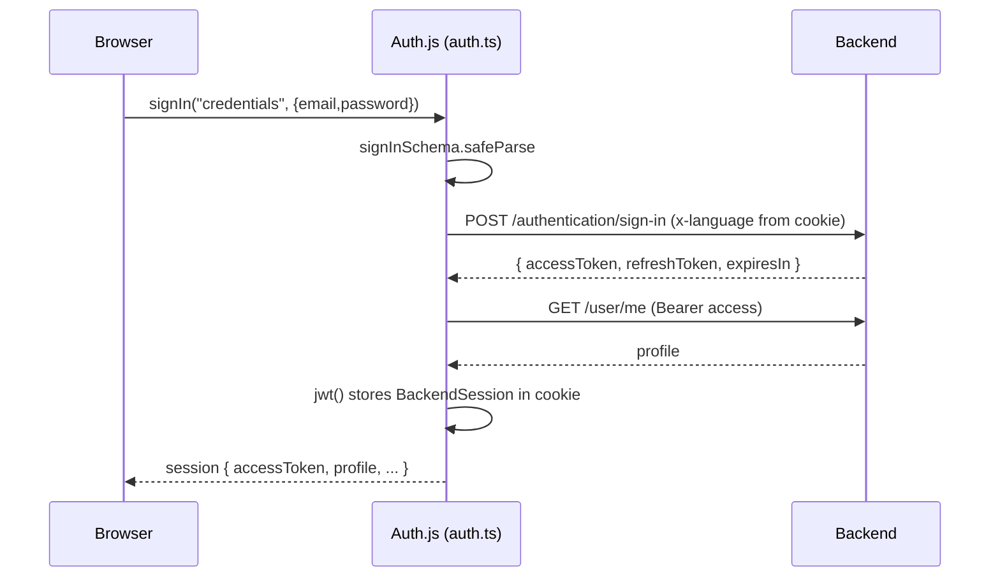

# 2. Authentication & Session

Auth is the most delicate part of the client. Read this fully before touching
`auth.ts`, `proxy.ts`, `lib/auth/*`, `lib/api/request.ts` or
`components/providers/session-bridge.tsx`.

## 2.1 Design in one paragraph

The backend issues an **access token** (short-lived JWT) and a **refresh token**
(~15 days). Auth.js stores both, plus a cached user profile, inside its own
**encrypted JWT session cookie**. Server code reads them with `auth()`. Client code
only ever sees the access token through `session.accessToken`, which
`SessionBridge` copies into the in-memory **`tokenStore`**. Refreshing happens on
the server inside the Auth.js `jwt` callback; the client asks for it by calling
`useSession().update(...)`.

## 2.2 Files

| File | Role |
|------|------|
| `auth.ts` | Auth.js config: Credentials + optional Google provider, `jwt`/`session` callbacks, refresh, server-side logout |
| `app/api/auth/[...nextauth]/route.ts` | Exposes Auth.js `GET`/`POST` handlers |
| `proxy.ts` | Redirects by sign-in state and role on every page request |
| `lib/auth/constants.ts` | `ROLE_HOME`, `AUTH_ROUTES`, `SIGN_IN_ROUTE`, `COMPLETE_PROFILE_ROUTE`, `REFRESH_SKEW_MS` (60 s) |
| `lib/auth/require-role.ts` | Server guard used in each role layout |
| `lib/auth/rotate.ts` | De-duplicates concurrent refresh-token rotations (process-wide map, 2 min grace) |
| `lib/auth/token-expiry.ts` | Reads `exp` from the JWT, falls back to `expiresIn` |
| `lib/auth/token-store.ts` | Client in-memory token + refresh coordination |
| `components/providers/session-bridge.tsx` | Syncs session → tokenStore, schedules proactive refresh, signs out on fatal errors |
| `types/next-auth.d.ts` | Augments `Session`, `User`, `JWT` |
| `validation/session.schema.ts` | Zod for token pairs, profile, and `update()` payloads |
| `hooks/use-sign-out.ts` | Full client sign-out |

## 2.3 Sign-in flows

### Email + password

Backend failures map to short codes thrown as `CredentialsSignin.code`
(`invalid`, `unverified`, `disabled`, `rate_limited`, `unavailable`). The sign-in
form turns those codes into translated messages (`lib/auth/sign-in-errors.ts`).

### Google
Enabled only when `AUTH_GOOGLE_ID` and `AUTH_GOOGLE_SECRET` are set
(`googleEnabled`). The `signIn` callback exchanges Google's `id_token` at
`POST /authentication/google`.

- If the backend answers `400 "City is required to create an account"`, the
  token is parked as `pendingGoogle` and the session gets `needsCity: true`.
  `proxy.ts` then forces the user to `/complete-profile`, which calls
  `update({ kind: "complete-google", city })` to finish the exchange.
- Other errors redirect to `/sign-in?error=<google_*>`.

## 2.4 The JWT callback (heart of the session)

Order of checks in `jwt()`:

1. Fresh sign-in (`user.backend`) → store it.
2. Pending Google (`user.pendingGoogle`) → store only that.
3. `trigger === "update"` → `applyUpdate()` handles one of
   `complete-google | refresh | reload-profile` (validated by
   `sessionUpdateSchema`).
4. Token not near expiry (`now < exp - 60 s`) → return as is.
5. Otherwise → `refreshSession()`.

`refreshSession()` outcomes:

| Backend result | Session result | Effect |
|----------------|----------------|--------|
| success | new tokens, `error: undefined` | transparent |
| 400 / 401 / 403 | `error: "RefreshTokenError"`, tokens dropped | user is signed out |
| network / 5xx | `error: "RefreshUnavailable"`, old tokens kept | retried later |

`rotateRefreshToken()` guarantees two concurrent refreshes with the same refresh
token share one backend call — the backend rotates refresh tokens, so a second call
would fail and log the user out.

## 2.5 Client side: `tokenStore` and `SessionBridge`

`tokenStore` is a tiny module-level store:

- `get()` — current access token (used by `api.ts`, `protected-file.ts`, socket auth).
- `sync(session)` — apply a session; notifies subscribers when the token changes
  (the chat socket reconnects on change).
- `bind(update)` — `SessionBridge` registers `useSession().update`.
- `ensureFresh()` — awaits any in-flight refresh; refreshes if within the skew window.
- `forceRefresh()` — `update({ kind: "refresh" })`, de-duplicated via `inflight`.
- `clear()` — forget the token.

`SessionBridge` also:
- schedules `ensureFresh()` shortly before expiry,
- on `RefreshTokenError` / `GoogleSignInError` clears the store and signs out to
  `/sign-in?expired=1`.

## 2.6 Route protection (two layers)

1. **`proxy.ts`** — runs for every non-asset path (see its `matcher`):
   - `needsCity` → only `/complete-profile` allowed.
   - Auth routes (`/sign-in`, `/sign-up`, …) → signed-in users go to their home.
   - Role sections (`/admin`, `/doctor`, `/patient`) → signed-out users go to
     `/sign-in?callbackUrl=…` (+ `expired=1` after a failed refresh); users of
     another role go to their own home.
   - `/` → role home.
2. **`requireRole(role)`** in each role `layout.tsx` — repeats the check on the
   server and returns the `SessionProfile` used by the shell.

Never rely on hiding links for security; the backend enforces permissions and the
two layers above enforce navigation.

## 2.7 Sign-out

`useSignOut()` (client):
1. unregisters the push device token (or calls logout-everywhere),
2. disconnects the chat socket and clears `tokenStore`,
3. `signOut({ redirectTo: "/sign-in" })` → Auth.js `events.signOut` →
   `revokeOnServer()` revokes the refresh token on the backend,
4. resets chat state and the query cache (`queryClient.reset()`).

Always use `useSignOut()`; calling `signOut` directly leaks the device token and
cached data.

## 2.8 Changing auth safely

- Adding a field to the session: add it to `SessionProfile` (`types/next-auth.d.ts`),
  `profileSchema`, and `loadProfile()`. To refresh it at runtime call
  `update({ kind: "reload-profile" })`.
- Adding a new `update()` kind: extend `sessionUpdateSchema` and the `switch` in
  `applyUpdate()`.
- Adding a public route: add it to `AUTH_ROUTES` only if signed-in users should be
  bounced away; any path outside role sections is already public.
- Test: sign-in, wrong password, expired access token (wait or shorten TTL),
  revoked refresh token, two tabs refreshing at once, Google with and without city.

Next: [3. Data layer →](./03-data-layer.md)
